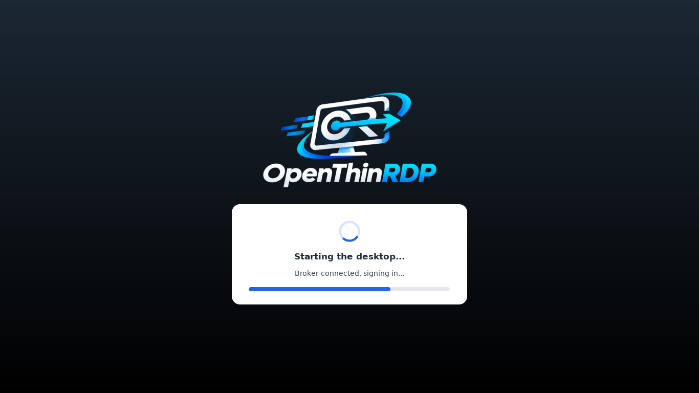
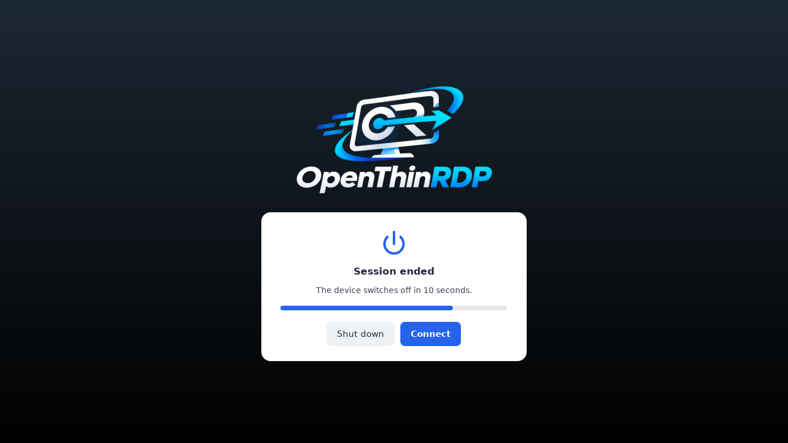
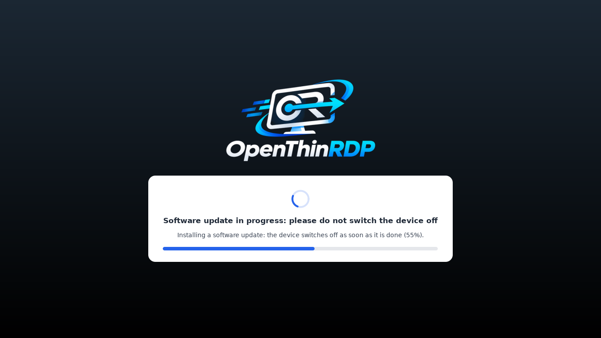

<p align="center"></p>

<p align="center"><b>Il sistema operativo per thin client open source con l'RDP su UDP<br>
per Desktop remoto Windows, RDS e VDI: FreeRDP con il trasporto UDP che la versione ufficiale non ha ancora.</b></p>

<p align="center">
<a href="https://github.com/OpenThinRdp/openthinrdp/releases/latest"><b>⬇ Scarica la ISO (ultima versione)</b></a>
&nbsp;·&nbsp; <a href="#provarlo-in-cinque-minuti">Provalo in live, senza installare niente</a>
&nbsp;·&nbsp; <a href="https://openthinrdp.github.io/it/">Sito</a>
&nbsp;·&nbsp; <a href="README.md">English</a>
</p>

<p align="center">


</p>

OpenThinRDP trasforma piccoli PC e vecchi thin client in postazioni che si accendono direttamente sul form di
accesso e si collegano a Windows: tramite il broker RDS al desktop o alla VM dell'utente, oppure direttamente a
un host di sessione o a qualsiasi PC Windows con Desktop remoto attivo. Si gestiscono da una cartella condivisa:
stato di ogni postazione, configurazione centrale, logo, aggiornamenti firmati. Niente agenti, niente server di
gestione, niente cloud, nessuna licenza per postazione.

È nato da una migrazione reale da un sistema thin client commerciale, su un parco di Dell OptiPlex 3000 Thin
Client collegati a una VDI Windows 11 su Hyper-V, dove il sistema da cui deriva lavora ogni giorno.

> **Stato: in produzione ogni giorno.** Fa girare tutti i thin client dell'azienda da cui nasce: 14 Dell OptiPlex
> 3000 Thin Client in ufficio, alle casse, in laboratorio e alle pese, con una VDI Windows 11 su Hyper-V dietro due
> RD Connection Broker. Le postazioni sono state convertite sul posto dal sistema che avevano prima e ricevono
> ogni versione come pacchetto firmato dalla loro cartella di gestione, installato durante le sessioni e applicato
> quando la sessione finisce. Gli aggiornamenti di sicurezza di FreeRDP arrivano in OpenThinRDP
> [entro 7 giorni](SECURITY.md#freerdp-security-fixes) (la 3.32.2: in quattro ore). La ISO è provata in QEMU/KVM
> con Secure Boot a ogni versione. Cosa è in produzione, cosa è solo
> provato e cosa non c'è ancora: **[docs/status.md](docs/status.md)**. Provatela in live, poi su una postazione,
> prima di estenderla.

## RDP su UDP che regge anche su una linea pessima

Tutto è partito da una porta di switch guasta che perdeva il 43% dei pacchetti grandi: in TCP il desktop remoto
si bloccava. Abbiamo riprodotto quella linea e poi alzato la perdita su tutti i pacchetti della macchina virtuale
un gradino alla volta (VDI Windows 11, carico a schermo intero che cambia ogni pixel, fotogrammi misurati dal
server):

| pacchetti persi | in TCP | **OpenThinRDP in UDP** |
|---|---|---|
| 20% | 0,6 fotogrammi al secondo: lo schermo quasi non si muove | non misurato (19-21 fps al 50%) |
| 43% di quelli grandi\* (la porta guasta) | 0-0,1 fps | **16-21 fps**, 7 minuti di fila |
| 50% | non misurato (0,2 fps già al 30%) | **19-21 fps**, come su una linea pulita |
| 70% | non misurato | **18-19 fps**\*\* |
| 80% | non misurato | 4 fps, poi il tunnel si arrende |

\* Le altre righe perdono quella quota di tutti i pacchetti; questa il 43% dei pacchetti grandi e il 5% dei piccoli.
\*\* Al 70% la connessione TCP che RDP tiene accanto al tunnel può chiudere la sessione dopo 20 s senza conferme.
Un solo ambiente (Dell OptiPlex 3000 Thin Client, VDI Windows 11 su Hyper-V), perdita simulata con netem:
[metodo e script](tests/udp-bench/README.md) per avere i vostri numeri.

Per arrivarci è servita una correzione al trasporto UDP di FreeRDP, che abbiamo trovato e segnalato in
[#13608](https://github.com/FreeRDP/FreeRDP/pull/13608) e che ora ne fa parte. Tutti i gradini e i numeri del TCP:
[docs/udp.md](docs/udp.md#on-a-lossy-line).

## Per chi è

- Pubblicate desktop con **Servizi Desktop remoto di Windows**: broker RDS con host di sessione o raccolta VDI su
  Hyper-V. Oppure non c'è nessun broker: ogni postazione si collega a un PC o server Windows (al posto del broker
  si mette il suo nome), per esempio una reception che lavora sul PC dell'ufficio.
- Avete **PC o thin client x86-64 con UEFI** (Secure Boot funziona) e volete tenerli in servizio senza una licenza
  per postazione.
- Volete **provare RDP in UDP** su client veri, o aiutarlo a entrare in FreeRDP.

Non (ancora) per voi: Citrix, VMware/Omnissa Horizon e altri protocolli (OpenThinRDP fa solo RDP), dispositivi
ARM, PC senza UEFI.

## Provarlo in cinque minuti

1. [Scaricate `openthinrdp-<versione>.iso`](https://github.com/OpenThinRdp/openthinrdp/releases/latest) e scrivetela
   su una chiavetta con qualsiasi programma che scriva immagini (Rufus in modalità DD, balenaEtcher, `dd`).
2. Avviate il PC dalla chiavetta. Il menu fa partire da solo il **sistema live** dopo 10 secondi: gira dalla
   chiavetta e **non scrive mai sul disco**.
3. Si apre la configurazione: impostate il broker (o il nome di un PC Windows) e il dominio, salvate, accedete.
4. Vi piace? Riavviate e scegliete **Install**: mostra il disco che sta per cancellare e chiede conferma prima
   di scrivere qualsiasi cosa (confermate per proseguire), poi circa tre minuti. Installa sul **primo disco interno**, mai
   su un disco USB (nemmeno la chiavetta). Per le installazioni in serie, *Unattended install* salta la domanda.

Serve un PC x86 a 64 bit con UEFI, 2 GB di RAM e 8 GB di disco per l'installazione. Hardware provato:
[docs/hardware.md](docs/hardware.md).

## Cosa fa

- **Desktop remoto in UDP.** Windows manda la grafica in UDP e adatta fotogrammi e qualità alla linea invece di
  accumulare ritardo: più fluido con server carichi, Wi-Fi con perdite e VPN. L'immagine contiene FreeRDP
  compilato con il trasporto UDP ancora in revisione ([FreeRDP #13608](https://github.com/FreeRDP/FreeRDP/pull/13608)).
  Per postazione: `auto` (UDP, TCP se l'UDP è bloccato), `udp` (solo UDP) o `tcp`. Nella nostra prova di 3 ore con
  perdita di pacchetti, banda limitata, rete staccata e client uccisi la sessione è rimasta sempre in UDP
  ([risultati](https://github.com/FreeRDP/FreeRDP/pull/13608#issuecomment-6110587552)). Vedi [docs/udp.md](docs/udp.md).
- **Form di accesso, poi desktop remoto a schermo intero**, avvio in pochi secondi con il vostro logo.
  Tentativi, broker di riserva, messaggi chiari per rete assente, broker irraggiungibile, macchina virtuale che
  non parte, password sbagliata (mai ritentata, così l'account non si blocca).
- **Si riconnette da solo** dopo le cadute di rete, si ferma quando la sessione viene chiusa apposta (disconnetti,
  esci, VM spenta dall'amministratore), e avvisa prima di prendersi una sessione aperta su un'altra postazione.
- **USB pensato per la VDI**: chiavette di firma, chiavi tachigrafo e altri dispositivi particolari vanno a
  Windows interi, anche collegati a sessione aperta. **Webcam e cuffie funzionano in riunione**: la telecamera
  passa dal canale telecamera di RDP e il microfono dal canale audio, così Teams, Zoom e il browser della sessione
  li vedono entrambi (un microfono passato come dispositivo USB resta fuori dalla sessione remota). Tastiere,
  mouse, touch, hub e schede di rete restano locali; i lettori di smart card passano dal canale smart card.
- **Gestione da una cartella condivisa (SMB).** Ogni postazione ci scrive stato e registro eventi; un gestore
  Windows (italiano e inglese, nessuna installazione) li mostra, modifica la configurazione di tutte o di una
  postazione, le chiavi SSH, logo e immagine di sfondo (per tutte o per una), e porta nella cartella le release di
  GitHub. Le impostazioni della cartella vincono sulle modifiche locali.
- **Aggiornamenti firmati**, mai durante una sessione: dalle release di GitHub, o dalla vostra cartella quando
  decidete voi. Gli aggiornamenti di sicurezza Debian si installano da soli.
- **Configurazione sulla postazione** (anche protetta da PIN): broker o PC, rete (DHCP, statica, Wi-Fi), cartella
  di gestione e il suo account, modalità USB, pulsante web, orari, lingua. Una postazione nuova prende il nome
  dalla propria scheda di rete (`thinclient-1a2b3c`).
- **Diagnostica per l'assistenza**, senza PIN (il pulsante ℹ): rete, raggiungibilità di ogni broker o PC, ora,
  cartella di gestione, ultimi eventi. Solo lettura.
- **Blindata**: niente desktop, niente menu, niente console di testo (Ctrl+Alt+F1..F12 non fanno nulla), nessun
  account senza password.
- **Più monitor** diventano un unico desktop remoto su tutti (`MULTIMON`).
- Orari di accensione e spegnimento, Wake-on-LAN, pulsante web con Chromium (app, browser o pagina kiosk).
- Interfaccia in italiano e inglese.

<p align="center">


</p>

<p align="center">



</p>

## Perché è fatto così

**Perché FreeRDP non si aggiorna da solo.** Gli aggiornamenti di sicurezza di Debian si installano da soli, ma
FreeRDP è escluso. Primo, l'immagine contiene un FreeRDP compilato con l'UDP, che i pacchetti Debian
sostituirebbero con una versione senza. Secondo, il client di desktop remoto è la parte da cui dipendono gli
utenti: una versione nuova può cambiare il comportamento di sessioni, dispositivi USB, smart card o grafica, e su un
parco di postazioni un difetto ferma tutti nello stesso momento. Per questo FreeRDP arriva con le release di
OpenThinRDP, dopo la prova su postazioni vere, e si può comunque bloccare su una singola postazione
(`/etc/openthinrdp/freerdp-pinned`).

**Perché l'UDP da una pull request non ancora unita.** In TCP un server carico o una linea con perdite fanno
restare indietro lo schermo; in UDP Windows abbassa invece la qualità. Nelle nostre prove la pull request è solida,
e l'unico modo perché venga unita è che qualcuno la usi e segnali. `TRANSPORT=tcp` è a un'impostazione di
distanza, e l'immagine segue il codice di FreeRDP mentre cambia.

**Perché una cartella condivisa e non un server di gestione.** Ogni rete Windows ha già una condivisione e
qualcuno che ne gestisce i permessi. Le postazioni leggono e scrivono solo file lì: niente da installare,
aggiornare o licenziare lato server, e le impostazioni sono file di testo che si leggono, si confrontano e si
salvano.

**Perché Debian.** Stabile, aggiornamenti di sicurezza per anni, tutti i driver e i firmware, e sopra un kiosk
che si può leggere: tutta la parte client sono pochi script in `rootfs/opt/openthinrdp`.

## Confronto

| | **OpenThinRDP** | Dell ThinOS | IGEL OS | Stratodesk NoTouch | ThinStation |
|---|---|---|---|---|---|
| Costo | gratuito | incluso nei thin client Dell | abbonamento per postazione | licenza per postazione | gratuito |
| Sorgente | aperto (Apache 2.0) | chiuso | chiuso | chiuso | aperto |
| Gira su | PC e thin client x86-64 con UEFI | thin client Dell | molti dispositivi x86-64 | PC x86-64, Raspberry Pi | PC x86 |
| Protocolli | solo RDP | Citrix, Omnissa/VMware, Microsoft e altri | Citrix, Omnissa/VMware, Microsoft e altri | molti | molti (immagine da costruire) |
| Gestione | cartella condivisa + strumento Windows, nessun server | Wyse Management Suite | server UMS | NoTouch Center | file di configurazione su un server di rete |
| Aggiornamenti | firmati, da GitHub o dalla vostra cartella | firmware del produttore | del produttore | del produttore | si ricostruisce l'immagine |
| Installazione | ISO, live o installazione automatica | preinstallato | installatore o preinstallato | installatore | si costruisce, poi PXE o USB |

Se servono Citrix o Horizon, il supporto di un produttore o hardware certificato, i sistemi commerciali sono la
scelta giusta. OpenThinRDP è per le reti basate su Desktop remoto Windows che vogliono un client libero, gratuito
e semplice da gestire, e per chi vuole mettere al lavoro il trasporto UDP di FreeRDP. I nomi dei prodotti sono
marchi dei rispettivi proprietari; il confronto riflette informazioni pubbliche e la nostra comprensione,
correzioni benvenute.

## I prossimi passi

Le idee che vorremmo realizzare, più o meno in quest'ordine. Diteci in una issue quali vi servono, o mandate una
pull request:

- **VPN**: WireGuard e OpenVPN, così una postazione a casa o in una sede distaccata raggiunge il broker da sola.
- **RD Gateway**: Desktop remoto in HTTPS da fuori rete, senza VPN.
- **Wi-Fi con 802.1X** (WPA-Enterprise) e 802.1X sulla rete cablata.
- **Installazione da rete (PXE)** per molte postazioni insieme.
- **Altro hardware provato** e altre lingue (un file ciascuna).

## Costruire la propria immagine

Con il vostro logo, broker, impostazioni e chiavi già dentro (Linux con Docker o Podman):

```
cp -r image/site.example image/site      # poi modificare site.conf, build.conf, aggiungere il logo
image/build.sh                           # -> out/openthinrdp-<versione>.iso
```

La documentazione è in inglese nella cartella [docs](docs/); le novità di ogni versione sono in [CHANGELOG.md](CHANGELOG.md).

## Contribuire

Issue e pull request sono benvenute, anche in italiano. I problemi di sicurezza vanno segnalati in privato,
vedi [SECURITY.md](SECURITY.md). Come contribuire: [CONTRIBUTING.md](CONTRIBUTING.md); regole di convivenza:
[CODE_OF_CONDUCT.md](CODE_OF_CONDUCT.md).

## Licenza

Apache License 2.0, vedi [LICENSE](LICENSE). OpenThinRDP usa FreeRDP (Apache 2.0) e pacchetti Debian con le loro
licenze. Windows e Desktop remoto sono marchi di Microsoft; il progetto non è affiliato a Microsoft né ai
produttori citati.
