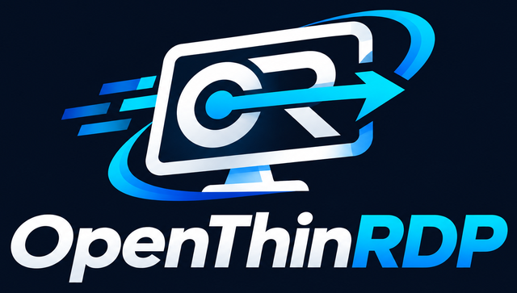
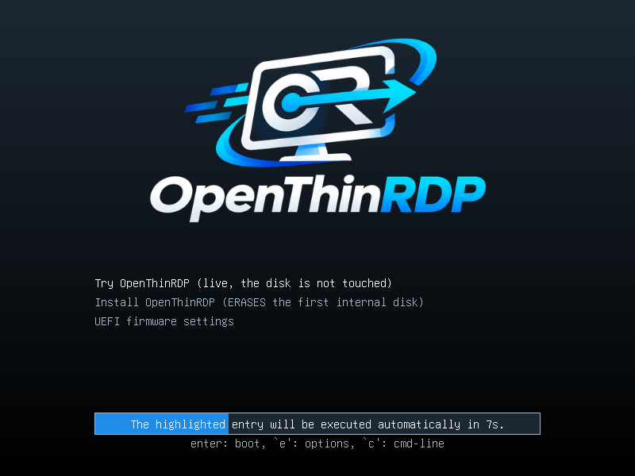
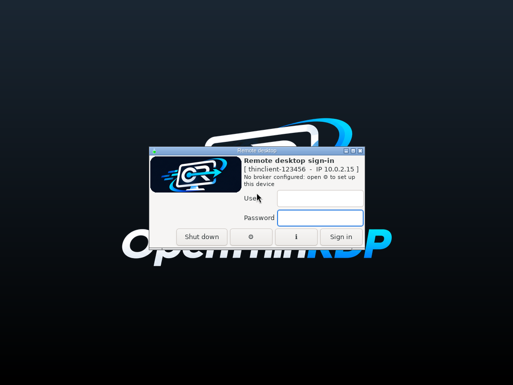
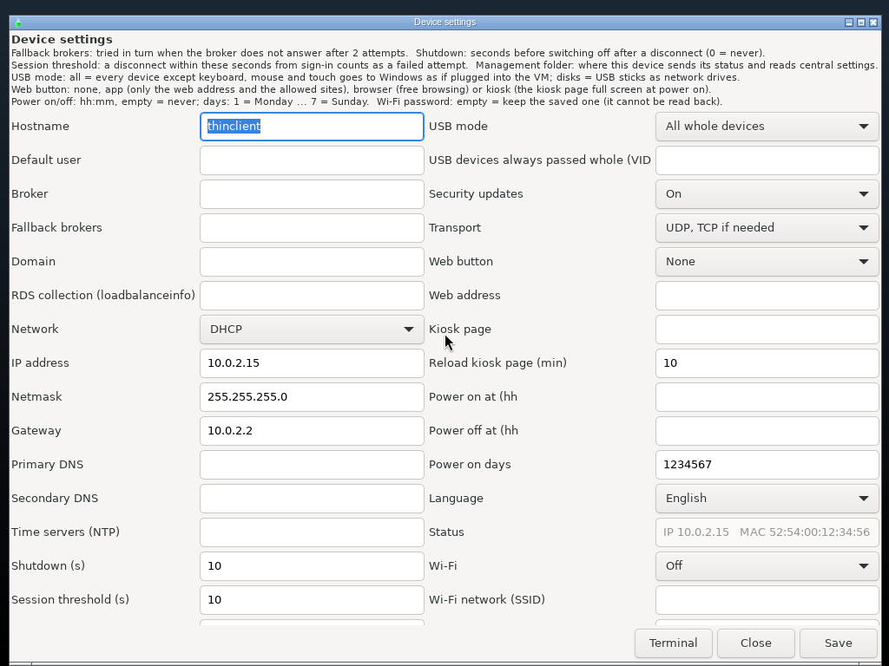
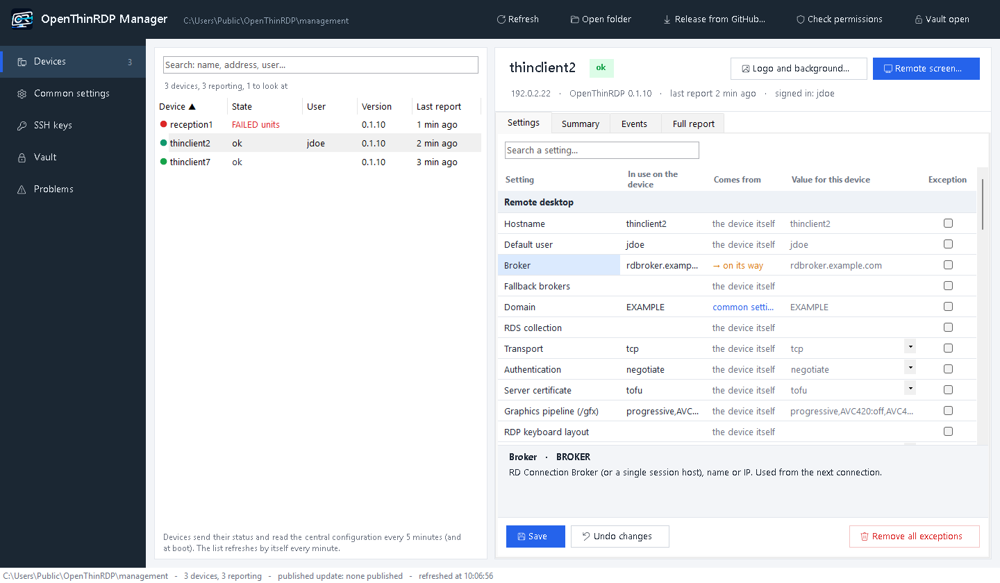
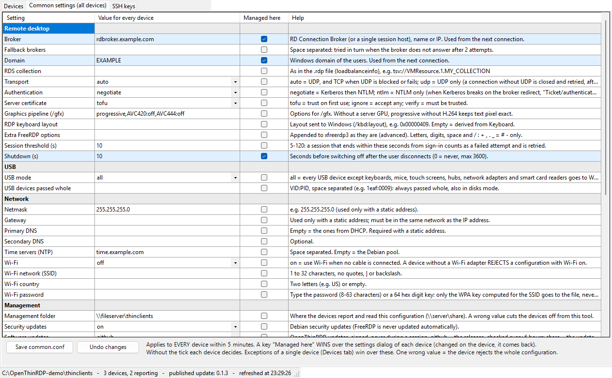

<p align="center"></p>

<p align="center"><b>A free, open source thin client OS for Windows Remote Desktop and VDI,<br>
with the UDP transport that FreeRDP does not ship yet.</b></p>

<p align="center">
<a href="https://github.com/Ceschi-ops/openthinrdp/releases/latest"><b>⬇ Download the ISO (latest release)</b></a>
&nbsp;·&nbsp; <a href="#try-it-in-five-minutes">Try it live, nothing installed</a>
&nbsp;·&nbsp; <a href="README.it.md">Italiano</a>
</p>

<p align="center">



</p>

OpenThinRDP turns small PCs and old thin clients into kiosks that boot straight into a sign-in form and connect
to Windows: through an RD Connection Broker to the user's desktop or VM, or straight to a session host or to any
Windows PC with Remote Desktop turned on. They are managed from a shared folder: status of every device, central
settings, logo, signed updates. No agent, no management server, no cloud, no licence per device.

It grew out of a real migration away from a commercial thin client OS, on a fleet of Dell OptiPlex 3000 Thin
Clients connected to a Windows 11 VDI on Hyper-V, where the system it comes from runs every day.

> **Status: alpha (0.1).** The code comes from a system in production, but this generic version is new. Try it
> live, then on one device, before you roll it out. Reports are very welcome.

## Who it is for

- You publish desktops with **Windows Remote Desktop Services**: RD Connection Broker with session hosts or a
  Hyper-V VDI collection. Or there is no broker at all: each device connects to one Windows PC or server (set
  its name instead of the broker), e.g. a reception desk that works on the PC in the office.
- You have **x86-64 PCs or thin clients with UEFI** (Secure Boot works) and want to keep them useful without a
  licence per device.
- You want to **try RDP over UDP** on real clients, or help bring it into FreeRDP.

Not for you (yet): Citrix, VMware/Omnissa Horizon and other protocols (OpenThinRDP does RDP only), ARM devices,
PCs without UEFI.

## Try it in five minutes

1. [Download `openthinrdp-<version>.iso`](https://github.com/Ceschi-ops/openthinrdp/releases/latest) and write it
   to a USB stick with any raw image writer (Rufus in DD mode, balenaEtcher, `dd`).
2. Boot the PC from the stick. The menu starts the **live system** by itself after 10 seconds: it runs from the
   stick and **never writes to the disk**.
3. The settings dialog opens: set the broker (or the name of a Windows PC) and the domain, save, sign in.
4. Like it? Restart and choose **Install**: about three minutes, no questions. It **erases the first internal
   disk** (never a USB disk, not even the installation stick).

Needs a 64-bit x86 PC with UEFI, 2 GB of RAM and 8 GB of disk for the installation. Tested hardware:
[docs/hardware.md](docs/hardware.md).

## What it does

- **Remote desktop over UDP.** Windows sends the graphics over UDP and adapts frame rate and quality to the line
  instead of queueing: smoother on busy servers, lossy Wi-Fi and VPNs. The image ships FreeRDP built with the UDP
  transport that is still under review upstream ([FreeRDP #13608](https://github.com/FreeRDP/FreeRDP/pull/13608)).
  Per device: `auto` (UDP, TCP when UDP is blocked), `udp` (UDP only) or `tcp`. In our 3-hour test with packet
  loss, bandwidth limits, network cuts and killed clients the session stayed on UDP the whole time
  ([results](https://github.com/FreeRDP/FreeRDP/pull/13608#issuecomment-6110587552)). See [docs/udp.md](docs/udp.md).
- **Sign-in form, then full screen remote desktop.** Boots in a few seconds with your logo, no desktop, no
  shell. Retries, fallback brokers, clear messages for "no network", "broker not reachable", "the virtual
  machine does not start", wrong password (never retried, so accounts are not locked).
- **Reconnects by itself** after network drops, stops when the session is ended on purpose (sign out,
  disconnect, VM shut down by an administrator), and warns before taking over a session open on another device.
- **USB done right for VDI.** Webcams with their microphone, signature keys, tachograph keys and other special
  devices go to Windows as whole USB devices, also when plugged in during the session. Keyboards, mice, touch
  screens, hubs and network adapters stay local; smart card readers go through the smart card channel.
  Touch screens work as touch in Windows.
- **Managed from a shared folder (SMB).** Each device writes its status and event log there; a Windows manager
  (English and Italian, no installation) shows them, edits the settings for all devices or one, the SSH keys,
  logo and background picture (for all devices or one), and brings GitHub releases into the folder. Settings that come
  from the folder win over local changes.
- **Signed updates**, never during a session: from GitHub releases, or from your folder when you decide.
  Debian security updates install by themselves.
- **Settings dialog on the device** (optionally behind a PIN): broker or PC, network (DHCP, static, Wi-Fi),
  management folder and its account, USB mode, web button, power schedule, language. A new device names itself
  from its network card (`thinclient-1a2b3c`).
- **Diagnostics for the help desk**, no PIN needed (the ℹ button): network, can each broker or PC be reached,
  time, management folder, last events. Read only.
- **Locked down**: no desktop, no menus, no text consoles (Ctrl+Alt+F1..F12 do nothing), no password-less
  account.
- **Several monitors** become one remote desktop spanning all of them (`MULTIMON`).
- **Power schedule and Wake-on-LAN**, screen always on, monitors switched on late handled.
- **Web button**: a web app, free browsing, or a full screen kiosk page, with Chromium.
- English and Italian interface; more languages are one file each.

<p align="center">


</p>

## Why it is built this way

**Why FreeRDP is not updated automatically.** Debian security updates install by themselves, but FreeRDP is
excluded. First, the image ships its own FreeRDP build with UDP, which Debian's packages would replace with a
version without it. Second, the remote desktop client is the part users depend on: a new FreeRDP version can
change how sessions, USB devices, smart cards or the graphics behave, and on a fleet a regression stops everyone
at the same moment. So FreeRDP comes with OpenThinRDP releases, after testing on real devices, and you can still
keep it as it is on one device (`/etc/openthinrdp/freerdp-pinned`).

**Why UDP from a pull request that is not merged yet.** Over TCP, a busy server or a lossy line makes the screen
fall behind; over UDP, Windows lowers quality instead. The pull request is solid in our tests, and the only way
it gets merged is people using it and reporting. `TRANSPORT=tcp` is one setting away, and the image follows the
upstream code as it changes.

**Why a shared folder instead of a management server.** Every Windows network already has a file share and
someone who can manage permissions on it. The devices only read and write files there, so there is nothing to
install, patch or license on the server side, and the settings are plain text files you can read, diff and back
up.

**Why Debian.** Stable, security updates for years, every driver and firmware package, and a kiosk on top of it
that you can read: the whole client side is a few shell scripts in `rootfs/opt/openthinrdp`.

## How it compares

| | **OpenThinRDP** | Dell ThinOS | IGEL OS | Stratodesk NoTouch | ThinStation |
|---|---|---|---|---|---|
| Cost | free | comes with Dell thin clients | subscription per device | licence per device | free |
| Source | open (Apache 2.0) | closed | closed | closed | open |
| Runs on | x86-64 PCs and thin clients with UEFI | Dell thin clients | many x86-64 devices | x86-64 PCs, Raspberry Pi | x86 PCs |
| Protocols | RDP only | Citrix, Omnissa/VMware, Microsoft and more | Citrix, Omnissa/VMware, Microsoft and more | many | many (you build the image) |
| Management | shared folder + Windows tool, no server | Wyse Management Suite | UMS server | NoTouch Center | configuration files on a network server |
| Updates | signed, from GitHub or your folder | vendor firmware | vendor | vendor | rebuild the image |
| Install | ISO, live or automatic installation | preinstalled | installer or preinstalled | installer | build, then PXE or USB |

If you need Citrix or Horizon, vendor support or certified hardware, the commercial systems are the right
choice. OpenThinRDP is for networks built on Windows Remote Desktop that want a free, open client that is simple
to manage, and for anyone who wants to put FreeRDP's UDP transport to work. Product names are trademarks of
their owners; the comparison reflects public information and our understanding, corrections are welcome.

## What comes next

Ideas we would like to build, roughly in this order. Tell us in an issue which ones you need, or send a pull
request:

- **VPN**: WireGuard and OpenVPN, so a device at home or in a branch office reaches the broker on its own.
- **RD Gateway**: Remote Desktop over HTTPS from outside the network, without a VPN.
- **Wi-Fi with 802.1X** (WPA-Enterprise) and wired 802.1X.
- **Network installation (PXE)** for many devices at once.
- **More tested hardware** and more languages (one file each).

## Build your own image

Your logo, your broker, your settings and keys built in (Linux with Docker or Podman):

```
cp -r image/site.example image/site      # then edit image/site/site.conf and build.conf, add your logo
image/build.sh
```

The result is `out/openthinrdp-<version>.iso`. See [docs/building.md](docs/building.md).

## Documentation

- [CHANGELOG.md](CHANGELOG.md): what changed in each release.
- [docs/configuration.md](docs/configuration.md): every setting.
- [docs/management.md](docs/management.md): the management folder, central settings, SSH keys, signed updates.
- [docs/building.md](docs/building.md): building and customizing the image.
- [docs/security.md](docs/security.md): security model and known limits.
- [docs/hardware.md](docs/hardware.md): tested hardware and firmware settings.
- [docs/udp.md](docs/udp.md): the UDP transport and the FreeRDP the image ships.

## Layout

| Folder | Content |
|---|---|
| `rootfs/` | everything installed on the thin client (`/opt/openthinrdp`, udev rules, systemd units) |
| `image/` | the ISO build (live-build in a container), the FreeRDP build and the example site folder |
| `management/windows/` | the Windows manager (PowerShell, no installation) |
| `management/publish/` | building and signing update packages |
| `tests/` | tests that run in a Debian container |

## Contributing

Issues and pull requests are welcome. Please describe the hardware and the Windows side (broker, session
host version) for anything related to connections or devices. See [CONTRIBUTING.md](CONTRIBUTING.md) and the
[code of conduct](CODE_OF_CONDUCT.md).

Security problems: please report them privately, see [SECURITY.md](SECURITY.md).

## License

Apache License 2.0, see [LICENSE](LICENSE). OpenThinRDP uses FreeRDP (Apache 2.0) and Debian packages under
their own licenses. Windows and Remote Desktop are trademarks of Microsoft; this project is not affiliated with
Microsoft or with any vendor named above.
