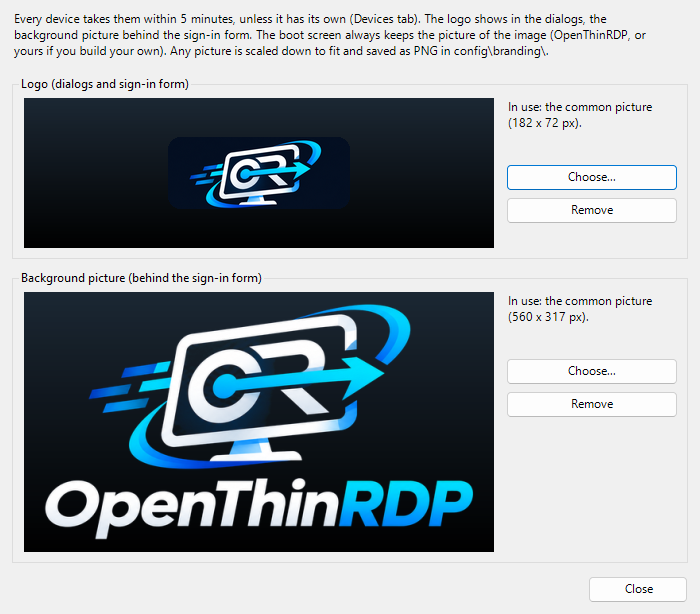

# Management folder

One SMB share (a folder on any Windows or Samba file server) is the whole management system. Every device
mounts it every 5 minutes, at boot and at every new event, writes its status and reads settings and updates.

```
\\fileserver\thinclients\
  status\<hostname>.txt        status: KEY=value lines + last errors and events
  status\<hostname>-events.log event log
  status\SUMMARY.csv           one line per device (rewritten by the devices)
  config\common.conf           settings for every device
  config\<hostname>.conf       settings for one device (wins over common.conf)
  config\authorized_keys       SSH public keys of the administrators (optional)
  config\branding\logo.png, splash.png              logo and background picture for every device (optional)
  config\branding\<hostname>\logo.png, splash.png   for one device (wins over the common ones)
  config\backup\, changes.log  written by the Windows manager
  updates\LATEST.txt(.sig)     signed update index, and the packages
```

## Account

The devices log in with `/etc/openthinrdp/smb.cred` (root only). Two ways to get it there:

- **On the device**, also with the downloadable ISO: in the settings dialog, *Management folder user*
  (`user`, `DOMAIN\user` or `user@domain`; without a domain, `DOMAIN` is used) and *Management folder
  password*. The user is a normal setting (`MGMT_USER`); the password goes only into `smb.cred`, is never shown
  again, never in the status files, and an empty field keeps the saved one. Central settings can change both
  (`MGMT_USER=`, `MGMT_PASSWORD=` in `config\common.conf` or `config\<hostname>.conf`), e.g. to rotate it.
- **In your own image**: `image/site/smb.cred`:

  ```
  username=svc-thinclients
  password=...
  domain=EXAMPLE
  ```

Every device can read this password, so use an account that can do as little as possible: not a member of
Domain Users, no rights outside this folder, and inside it **write access to `status\` only**. A device only
writes its status and events there; settings, branding and updates it only reads. So a stolen device gives
its holder an account that can fill `status\` with nonsense, but cannot change the settings of the other
devices or put anything in `updates\`.

| folder | devices' account | administrators |
|---|---|---|
| the management folder itself | Read (to list and open the subfolders) | Full control |
| `status\` | Modify | Full control |
| `config\` (with `branding\`) | Read | Full control |
| `updates\` | Read | Full control |

With PowerShell on the file server (example account `EXAMPLE\svc-thinclients`, folder `D:\thinclients`):

```powershell
icacls D:\thinclients /grant "EXAMPLE\svc-thinclients:(OI)(CI)RX"
icacls D:\thinclients\status /grant "EXAMPLE\svc-thinclients:(OI)(CI)M"
```

The icacls lines only add rights: whatever the folder inherits stays, and a group such as Users or Domain
Users with write access inherited from above still lets the devices, or every user, change the settings.
**Check permissions** in the Windows manager reads the permissions of the folder for the account the devices
report (`MGMT_ACCOUNT` in their status, from 0.1.6; older devices: it asks for the account) and lists:

- whether the devices can write in `status\`;
- every place outside `status\` they can change (the folder itself, `config\` and its files, logos,
  `updates\`), and through which account or group;
- every place outside `status\` that Everyone, Authenticated Users, Users or Domain Users can change.

It follows the order of the rules as Windows does (the first rule that allows or denies a right decides it),
and the groups of the account in the domain, nested ones included. It reads the NTFS permissions only: the
permissions of the share can only take rights away. Check also from a device that the account cannot list
anything outside the folder.

## Central settings

`config\common.conf` and `config\<hostname>.conf` hold the same keys as [configuration.md](configuration.md).
Files saved on Windows are fine (BOM, CRLF, spaces around `=`, `#` and `;` comments). A device:

- merges common, then its own file, over its current settings;
- validates the result with the same rules as the settings dialog, and applies it only if something changed;
- refuses the whole result if anything is invalid (event "central configuration REJECTED", reported once),
  keeping the previous settings;
- keeps the last good copy when the folder is unreachable.

Central values win: a key in the central files is written into the device settings at every run (every 5
minutes and at boot), so a change made in the settings dialog of a device lasts only until then. Keys that the
central files do not set stay as set on the device.

Removing a key from the central files gives it back to the device defaults: the device drops it from its
settings and follows `site.conf` or the project defaults again, like a device installed today. If the result
would not be valid (e.g. removing `WEB_URL` while `WEB_BUTTON=app` stays), the key is kept, the event is logged
once and the release is retried at every run.

The Windows manager (`management/windows/OpenThinRDP-Manager.vbs`, or the `.cmd` to pass `-Folder`/`-Language`) shows the devices, their status and events,
and edits these files with the same validation, a backup of every file it overwrites and a change log.
Before saving `common.conf` it lists the devices that would reject it.
It is available in English and Italian: it follows the Windows display language (English for any language
without a file in `management/windows/lang/`), or `-Language en` / `-Language it` chooses one.

## Logo and background picture

`logo.png` is the logo of the dialogs and of the sign-in form; `splash.png` is the background picture, shown
behind the sign-in form on the `BG_TOP`/`BG_BOTTOM` gradient. In `config\branding\` they are for every device,
in `config\branding\<hostname>\` for that device only; a device without them uses the ones of its image.
The manager's **Logo and background...** button (common settings, or a device) takes any picture, scales it
down and saves it as PNG there; files copied by hand are fine too.

<p align="center"></p>

The boot screen never changes from here: it always shows the picture and colors of the image (OpenThinRDP's,
or your own when you build your image with `image/site/splash.png`). At power on the device shows the boot
screen, then the background of your site from the sign-in form on.

A device accepts PNG files only, up to 2 MB, a logo up to 400 x 240 pixels and a background up to 1024 x 640
(anything else is refused once with an event, and the previous picture stays), and shows them within 5
minutes. The status file says where each picture comes from: `BRANDING=logo=common splash=image` (`image`,
`common` or `device`).
## Problems across the fleet

Every device sends its event log to `status<hostname>-events.log`. The **Problems** tab of the Windows manager
reads them all together for a period (today, 24 hours, 7 or 30 days) and groups what went wrong: sign-in attempts
that failed (by the broker really contacted), desktops that did not start, sign-ins refused, sessions dropped (by
cause: network lost, FreeRDP stuck, error code), sessions taken over, UDP blocked, failed updates, rejected settings.
Each line says how many times, on which devices and for which users, first and last time; a line is orange when the
same problem hit 3 or more devices, which points at a server or the network rather than at a device. The line at
the top sums up the problems that touched most devices; selecting a line shows its events. A device keeps the last
2000 lines of its log, which is weeks for a normal device.

## SSH keys

With `SSH=on`, the `otradmin` account accepts only the keys in `/etc/openthinrdp/authorized_keys`: from the image
(`image/site/authorized_keys`) or from `config\authorized_keys`. Removing `config\authorized_keys` after it
was used revokes those keys and brings back the image ones.

## Signed updates

Software updates (kiosk, FreeRDP with UDP, fixes) come from where `UPDATE_FROM` says:

| `UPDATE_FROM` | Source | Signature accepted |
|---|---|---|
| `github` (default) | the latest release of `UPDATE_GITHUB` (not pre-releases), asked every 6 hours | the project key only |
| `share` | `updates\` in the management folder: you decide when the devices get a version | the project key, or your own key |
| `off` | none | |

The project key is `/opt/openthinrdp/keys/openthinrdp-release.asc`, in the image and in every update
(fingerprint `8552 734B 5C1B 67D7 C576 F1AB 79B2 3AE6 1CD4 F6AF`, see [SECURITY.md](../SECURITY.md)). A
device installs a package only if `LATEST.txt` carries a valid signature, the hash of the package matches, and
the version is newer than the installed one (or than the image, when no update was installed yet).
Installation runs in the background and never interrupts a session: the new kiosk starts at the next sign-in.
Three failed attempts per version at most. The status file shows the source (`UPDATE_FROM`) and the result.

**A fleet you manage**: set `UPDATE_FROM=share` in `config\common.conf` and `UPDATE_FROM=github` in the
`config\<hostname>.conf` of one or two pilot devices. When the pilots are fine with a release, copy its three
files (`LATEST.txt`, `LATEST.txt.sig`, `openthinrdp-update-<version>.tar.gz`) into `updates\`: every device
checks the project signature itself, nothing has to be re-signed.

**Your own packages** (changes of yours, or your site files) need your own key, built into your image as
`/etc/openthinrdp/update-key.asc`. Create it once, on a machine you trust, and keep the private part offline:

```
gpg --quick-gen-key "Thin client updates <it@example.com>" ed25519 sign never
gpg --armor --export it@example.com > image/site/update-key.asc
```

Publish a version (Linux, WSL or Git Bash with Gpg4win; the folder mounted or reachable as a path):

```
management/publish/make-update.sh -v 2026.10.1 -k it@example.com -o /mnt/thinclients
```

`-d <folder>` adds `.deb` files (e.g. your own FreeRDP build, installed only when newer); `-s image/site`
ships your site files too. To keep FreeRDP as it is on one device, create `/etc/openthinrdp/freerdp-pinned`
with the reason inside.
