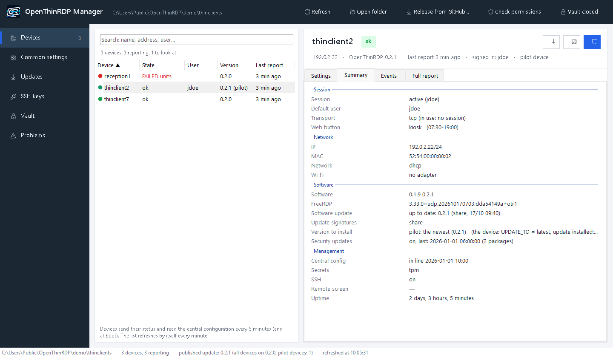
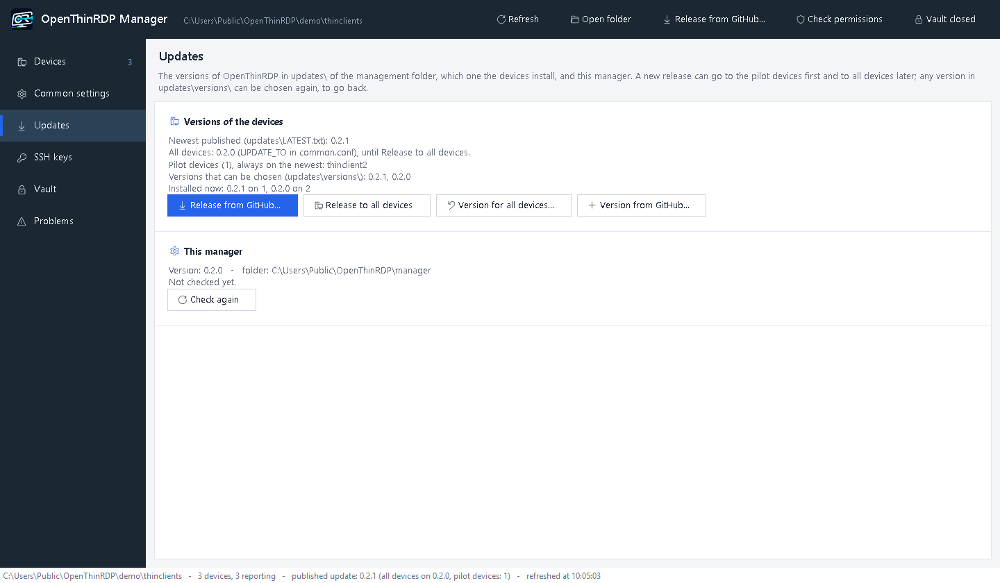
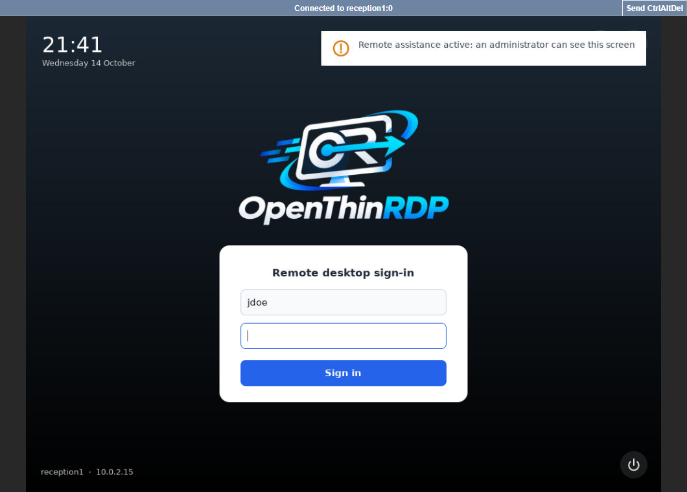
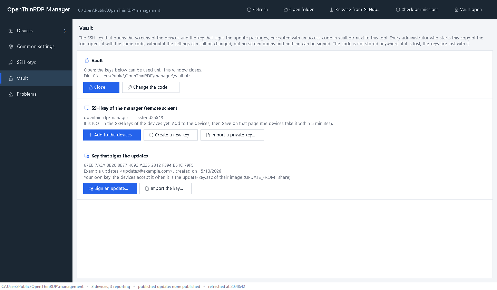

# The OpenThinRDP manager

The manager is the one place where you run a fleet of OpenThinRDP devices: one PowerShell script for Windows 10/11,
in English and Italian, with nothing to install. It works on the shared folder the devices report to: no server,
no agent, no database. What you see is the files in that folder, and everything you change is a file in that
folder too, with a backup and a line in the change log.

- [What you need](#what-you-need)
- [Devices: the whole fleet at a glance](#devices-the-whole-fleet-at-a-glance)
- [Settings for all devices or one](#settings-for-all-devices-or-one)
- [Updates: a few devices first, then all, and back when something breaks](#updates-a-few-devices-first-then-all-and-back-when-something-breaks)
- [Remote screen](#remote-screen)
- [Problems across the fleet](#problems-across-the-fleet)
- [Vault, keys and the site key](#vault-keys-and-the-site-key)
- [Logo, background, SSH keys, permissions](#logo-background-ssh-keys-permissions)
- [The manager updates itself](#the-manager-updates-itself)
- [Starting it, and the command line](#starting-it-and-the-command-line)

## What you need

- A **shared folder** (SMB) that the devices can read and write their status to: `\\fileserver\thinclients`. How
  to create it, its account and its permissions: [management.md](management.md#account).
- A **Windows 10 or 11 PC** of an administrator, with PowerShell 5.1 (it is part of Windows). For the remote screen,
  also the OpenSSH client of Windows (`ssh.exe`, usually there) and a browser.
- **The manager itself**: `openthinrdp-manager-<version>.zip` from the [latest release](https://github.com/OpenThinRdp/openthinrdp/releases/latest),
  unpacked into a folder only the administrators can write (a share works, so that everybody starts the same copy).
  From then on it [updates itself](#the-manager-updates-itself).
- The devices set to that folder: `MGMT_SHARE` in their settings dialog, or in the image you build.

Start `OpenThinRDP-Manager.vbs` (no console window) or `OpenThinRDP-Manager.cmd -Folder \\fileserver\thinclients`.

## Devices: the whole fleet at a glance

The **Devices** page lists every device that reports to the folder, with a coloured dot for its state, the user
signed in, the version it runs and its last report; the search box finds a device by name, address or user. Devices
report every 5 minutes and at boot, and the list refreshes itself every minute. A device that stopped reporting,
rejected the central settings or has a failed service stands out in its colour.

Select a device and its header shows its address, version, last report and user, with its actions: **Remote
screen**, **Logo and background...**, **Software version...**. Under it:

| Tab | What it shows |
|---|---|
| Settings | every setting: the value in use on the device, where it comes from, and the value you set for it |
| Summary | a readable report: session, transport in use (UDP or TCP), network and Wi-Fi, software and FreeRDP, the version it installs, security updates, management, secrets, uptime |
| Events | the event log of the device: sessions, drops with their cause, updates, settings applied or rejected |
| Full report | the status file as the device wrote it |

## Settings for all devices or one

**Common settings** are for every device (`config\common.conf`); in a device's **Settings** tab, tick *Exception*
to give that device a value of its own (`config\<hostname>.conf`), which wins over the common one. Every row shows:

- the value **in use on the device** (from its last report);
- **where it comes from**: the device itself, the common settings, or an exception for this device;
- in orange, ***on its way***: a value you saved that the device has not applied yet. It reads the folder every 5
  minutes; when it stays orange, the device has refused the settings (its state says so).

The help of the selected setting is in full under the list. Before saving, the manager checks every value with the
same rules as the devices (a device refuses a whole configuration with one wrong value), and before saving the
common settings it lists the devices that would refuse them. Every save keeps a copy of the file in
`config\backup\` and adds a line to `config\changes.log`.

All the settings: [configuration.md](configuration.md).

## Updates: a few devices first, then all, and back when something breaks

The **Updates** page shows the newest version in the folder, the version all devices are on, the pilot devices,
the devices kept on a version of their own, the versions you can choose, and what the devices run now.

Everything here is one setting, `UPDATE_TO`, written for you in the right file:

| `UPDATE_TO` | where | means |
|---|---|---|
| `latest` | `common.conf` | every device takes each new version as soon as it is in the folder (the default) |
| a version, e.g. `0.2.0` | `common.conf` | every device stays on that version, or **goes back** to it |
| `latest` | `<hostname>.conf` | a **pilot device**: it takes the newest version even while the others stay |
| a version | `<hostname>.conf` | that device stays on, or goes back to, its own version |

A device installs a version also when it is **older** than its own, FreeRDP included, and installs nothing newer
until the setting changes. As always, an update never interrupts a session: it is installed in the background and
applied when the session is over.

### Try a new version on a few devices

1. **Choose the pilots.** In the header of a device, **Software version...** > *pilot device*. Pick devices that
   look like the rest of the fleet (the same model, the same kind of user), and users who will tell you when
   something is odd. The list marks them *(pilot)*.
2. **Bring the new version in for the pilots only.** **Release from GitHub...** (top bar or Updates page) downloads
   the latest release, checks its project signature and hash, and asks: *all devices* or ***pilot devices only***.
   With pilot only, all the other devices are first kept on the version they have (`UPDATE_TO=<that version>` in
   `common.conf`), and only then the new version goes into the folder.
3. **Watch the pilots** for a few days: their **Summary** and **Events**, and the **Problems** page.

### Release it to the whole fleet

When the pilots are fine: **Updates > Release to all devices**. `common.conf` goes back to `UPDATE_TO=latest`
and every device takes the new version within 5 minutes, each one when its session is over.

### Something broke: go back

- **The whole fleet:** **Updates > Version for all devices...**, choose the version that worked (newest first, from
  `updates\versions\`). Every device goes back to it, FreeRDP included, and stays there.
- **One device:** **Software version...** in its header > *its own version*.
- **A version that is no longer in the folder:** **Version from GitHub...** fetches it (the release `v<version>`,
  with the same checks) into the folder, without changing what the others get.

When the fix is out, **Release from GitHub...** again, pilots first, and **Release to all devices**.

**Good to know**

- Devices go back only to **0.2.0 or later**: older versions do not know `UPDATE_TO`.
- Devices that still run a version **before 0.2.0** ignore `UPDATE_TO` and take the newest version in the folder.
  The manager names them before a pilot-only release: the first time, release 0.2.0 to all devices, or update those
  devices first.
- With `UPDATE_FROM=github` (no management folder for updates) the same setting works: the devices fetch the release
  `v<version>` from GitHub.
- Every published version keeps its signed index in `updates\versions\`; the newest 3 packages stay in the folder,
  plus every version a device is kept on. Details: [management.md](management.md#pilot-devices-and-going-back).

## Remote screen

**Remote screen**, in the header of a device, shows its screen in your browser and lets you use it: to see what a
user sees, or to sign in once to a web page on a screen with no keyboard.

It goes **through SSH only**, with the key of the manager's vault and a one-time password: nothing new listens on
the network, and nothing is installed on your PC. The device shows *Remote assistance active* while it lasts and
records it in its events; it ends when you close the small window, or by itself after 2 hours. `REMOTE_SCREEN=off`
turns it off. How it works: [management.md](management.md#remote-screen).

## Problems across the fleet

The **Problems** page reads the event logs of every device together, for today, 24 hours, 7 or 30 days, and groups
what went wrong: failed sign-ins (by broker), desktops that did not start, sessions dropped (by cause), sessions
taken over, UDP blocked, failed updates, rejected settings. Each line says how many times, on which devices, for
which users, first and last time. A line is orange when 3 or more devices had the same problem: that points at a
server or the network, not at a device. "Six devices could not reach the broker this morning" is one line instead
of six logs.

## Vault, keys and the site key

Two keys rule the fleet: the SSH key that opens the screen of any device, and the key that signs the update packages
every device installs. The manager keeps both in `vault.otr`, next to it, encrypted with an **access code** that only
the administrators know. Every administrator who starts the same copy opens it with the same code; without the code
the settings can still be edited, but no screen opens and nothing is signed.

**A fleet on its own key.** With `UPDATE_KEY=site` your devices accept only updates signed by the key of your site,
which exists only in your vault. The manager checks each GitHub release (project signature and hash) and signs it
again with your key: a stolen project key installs nothing on your fleet. Set it up step by step:
[management.md](management.md#a-fleet-on-its-own-key).

## Logo, background, SSH keys, permissions

- **Logo and background...** (common settings, or a device): any picture, scaled and saved as PNG, for every device
  or one.
- **SSH keys**: the keys of the administrators, sent to every device (`SSH=on`); **Add the key of the manager** puts
  the vault's key there for the remote screen.
- **Check permissions** tells you what the account of the devices can do in the folder: it needs to write only its
  status, never the settings or the updates.
- The window fits any screen, from a 27" monitor to a laptop with display scaling (down to 860×560).

## The manager updates itself

Every release carries the manager of the same version, under the same signature as the update package. At start,
in the background, the manager checks the latest release; when there is a newer manager, the top bar shows
***Manager X available***. **Update the manager** downloads it, checks signature and hash, keeps the files it
replaces in `previous\`, and starts again. Your `vault.otr`, the launcher and anything that is not part of the
manager stay as they are; if anything fails, the previous files come back.

Update the copy the administrators start (on a share, from a PC that can write there): everybody who starts it gets
the new version. The **Updates** page shows the manager's version and has **Check again**. Details:
[management.md](management.md#the-manager-updates-itself).

## Starting it, and the command line

- `OpenThinRDP-Manager.vbs` starts it without a console window; `build-launcher.ps1` makes an `.exe` with the
  OpenThinRDP icon to pin to the taskbar, and with `-Install` a shortcut on each PC that starts the copy on the share
  ([details](management.md#central-settings)).
- `OpenThinRDP-Manager.cmd -Folder \\fileserver\thinclients -Language en|it`: the folder and the language (by default
  the Windows display language).
- `OpenThinRDP-Manager.cmd -Sign <folder>\LATEST.txt`: signs an update package you built with `make-update.sh`, with
  the key in the vault ([Signed updates](management.md#signed-updates)).
- `OpenThinRDP-Manager.cmd -UpdateManager`: updates the manager without a window (exit code 0 = updated, 1 = error,
  2 = nothing to do).

What is in the folder, file by file, and how the devices use it: [management.md](management.md).
